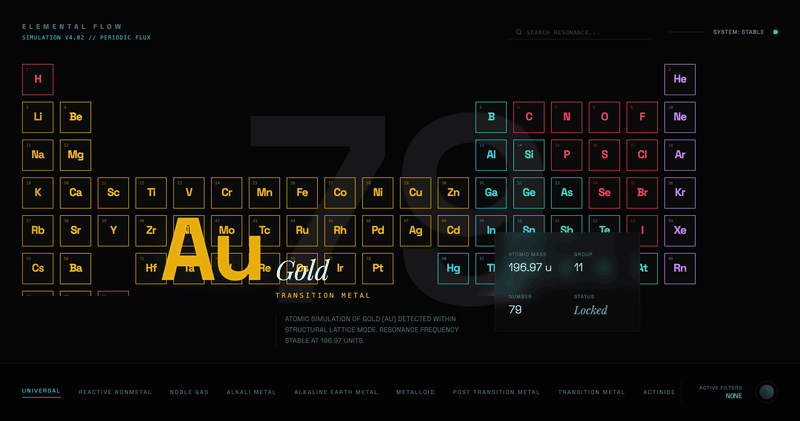
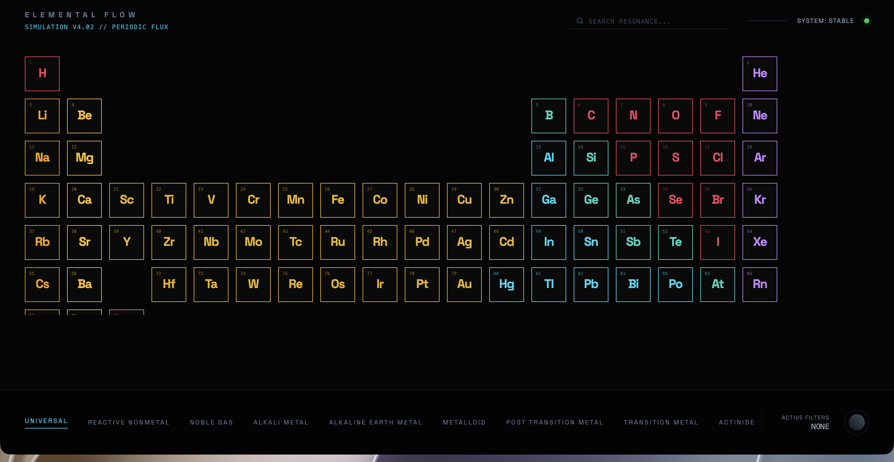
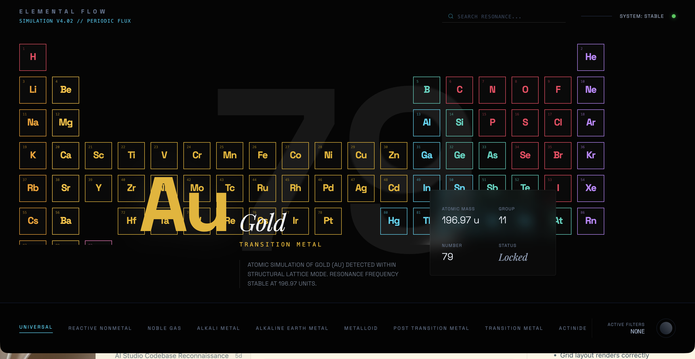
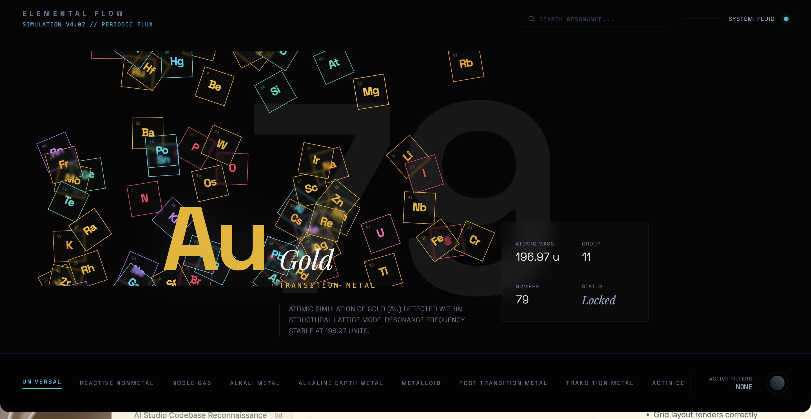

# Elemental Flow

A physics-inspired periodic table where 87 elements morph between a structured grid and a floating particle field. Click any element to lock its detail overlay, filter by category, or search by name.



## Quick Start

```bash
git clone https://github.com/avoirol/ais-elemental-flow.git
cd ais-elemental-flow
npm install
npm run dev
```

## States





## How It Works

**Toggle modes** with the status indicator (green dot, top right). **Click an element** to pin its detail overlay — shows symbol, name, category, atomic mass, group, and number. **Filter by category** using the footer nav. **Search** by element name or symbol.

Under the hood, each element card is absolutely positioned using its group/period coordinates in grid mode. In fluid mode, Framer Motion keyframe arrays drive continuous sinusoidal drift paths — each element gets randomized amplitude and phase so they feel organic, not synchronized. The staggered entrance animation uses per-element delay offsets (`staggerIndex * 0.008s`) for a cascading reveal on load.

## Tech Stack

| Layer | Tech |
|-------|------|
| Framework | React 19 |
| Build | Vite 6 |
| Styling | Tailwind CSS v4 |
| Animation | Framer Motion (motion) |
| Icons | Lucide React |
| Language | TypeScript |

## License

[MIT](LICENSE)
